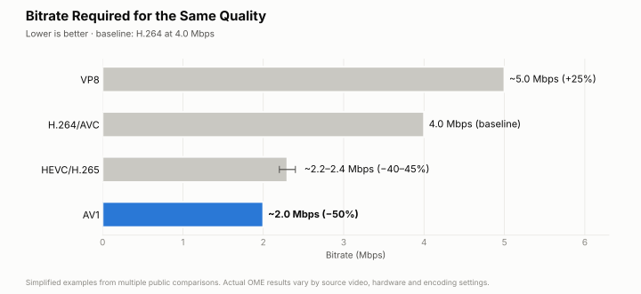
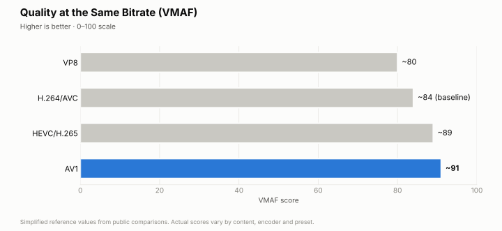
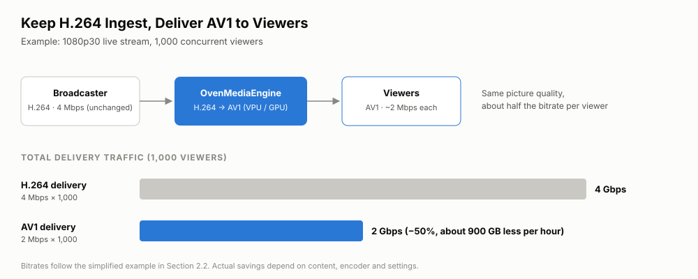
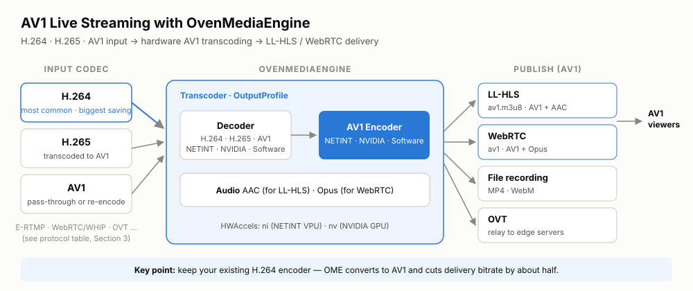

AV1 can deliver the same picture quality as H.264 at about half the bitrate. For a live service, where delivery traffic grows with every viewer, that is the most direct way to cut CDN costs.
And you do not have to change how you broadcast: keep sending H.264 from OBS or your existing encoder, and let OvenMediaEngine convert it to AV1 for viewers.

If you are evaluating AV1 for a live service on OvenMediaEngine (OME), this post walks you through the numbers, the hardware you need, and a working configuration for LL-HLS and WebRTC.

{/* truncate */}

## 1. Why AV1?

A streaming service has to deliver the best possible picture over limited network bandwidth.
A higher bitrate improves quality, but it also raises delivery costs and viewers' data usage, and it makes buffering more likely on poor networks.

AV1 tackles this with better compression, which gives you:

- Better quality at the same bitrate
- The same quality at a lower bitrate
- Lower CDN and network traffic costs
- More stable playback on constrained networks

To use AV1 in a real live service, however, compression efficiency is not enough. **Real-time encoding needs a lot of compute**, and **the delivery protocol you choose has to carry AV1**.

## 2. How much AV1 improves quality and cuts traffic

### 2.1 Bitrate at the same quality

At the same picture quality, AV1 needs a lower bitrate than older codecs.

| Codec      | Example bitrate for the same quality | Traffic vs. H.264 | At a glance               |
| ---------- | ------------------------------------ | ----------------- | ------------------------- |
| VP8        | ~5.0 Mbps                            | ~25% more         | Most traffic              |
| H.264/AVC  | 4.0 Mbps                             | **Baseline**      | Today's common baseline   |
| HEVC/H.265 | ~2.2–2.4 Mbps                        | ~40–45% less      | A bit over half of H.264  |
| AV1        | **~2.0 Mbps**                        | **~50% less**     | **Least traffic**         |



*Source: simplified from public comparisons by [Meta (2018)](https://engineering.fb.com/2018/04/10/video-engineering/av1-beats-x264-and-libvpx-vp9-in-practical-use-case/), [Meta (2023)](https://engineering.fb.com/2023/02/21/video-engineering/av1-codec-facebook-instagram-reels/), and [Netflix](https://netflixtechblog.com/performance-comparison-of-video-coding-standards-an-adaptive-streaming-perspective-d45d0183ca95).*

:::note
These values are simplified examples based on several public comparisons, meant to make the difference between codec generations easy to see. They are not absolute values measured in a single experiment, and results in your OME environment will vary with the source video, hardware, and encoding settings.
:::

### 2.2 Quality at the same bitrate

Conversely, at the same bandwidth, AV1 delivers higher quality.

| Codec      | Example VMAF (0–100) | Relative quality | At a glance                                  |
| ---------- | -------------------- | ---------------- | -------------------------------------------- |
| VP8        | ~80                  | Low              | Relatively heavy compression artifacts       |
| H.264/AVC  | ~84                  | **Baseline**     | Typical quality                              |
| HEVC/H.265 | ~89                  | High             | Better detail, less blocking                 |
| AV1        | **~91**              | **Highest**      | **Sharper picture, fewer compression artifacts** |



*Source: simplified from public comparisons by [Meta (2018)](https://engineering.fb.com/2018/04/10/video-engineering/av1-beats-x264-and-libvpx-vp9-in-practical-use-case/), [Meta (2023)](https://engineering.fb.com/2023/02/21/video-engineering/av1-codec-facebook-instagram-reels/), and [Netflix](https://netflixtechblog.com/performance-comparison-of-video-coding-standards-an-adaptive-streaming-perspective-d45d0183ca95).*

**References**

- [Meta — AV1 beats x264 and libvpx-vp9 in practical use case](https://engineering.fb.com/2018/04/10/video-engineering/av1-beats-x264-and-libvpx-vp9-in-practical-use-case/)
- [Meta — How Meta brought AV1 to Reels](https://engineering.fb.com/2023/02/21/video-engineering/av1-codec-facebook-instagram-reels/)
- [Netflix — Performance comparison of video coding standards: an adaptive streaming perspective](https://netflixtechblog.com/performance-comparison-of-video-coding-standards-an-adaptive-streaming-perspective-d45d0183ca95)

### 2.3 Traffic savings from converting H.264 ingest to AV1

You do not need to change your ingest setup to benefit from AV1.
Most broadcast hardware and software (OBS, for example) sends H.264, so you can keep sending H.264 and let OvenMediaEngine convert it to AV1 before it reaches viewers.
Most of the cost of live streaming is delivery traffic, which grows with every viewer, so reducing the bitrate sent to viewers has the largest impact.



For example, with 1,000 concurrent viewers watching a 1080p30 stream, H.264 delivery at 4 Mbps needs 4 Gbps, while AV1 at about 2 Mbps needs about 2 Gbps.
That is roughly 900 GB less traffic per hour.

:::note
These figures are calculated from the example bitrates in section 2.1. Actual savings depend on the content, the encoder, and its settings.
:::

### 2.4 Encoding cost and latency

AV1's compression efficiency comes at a price. It needs far more computation than H.264 or HEVC.
To squeeze out more compression, the encoder runs complex prediction and search steps, so reaching real-time performance with a software encoder alone takes a lot of CPU.

In our experience, software AV1 encoding is fine for limited testing or VOD production, but it is hard to justify at commercial scale because of its cost and low density. In live streaming in particular, you may run into:

- High CPU usage and server costs
- Fewer concurrent streams per server
- Lower compression efficiency from having to use faster presets
- Encoding delay and dropped frames when throughput falls short
- Limited scalability for high-resolution, high-frame-rate streams

For commercial live streaming today, dedicated hardware is the practical way to run AV1.

:::tip
OvenMediaEngine can encode AV1 on **hardware accelerators such as NETINT VPUs and NVIDIA GPUs**. Offloading encoding to dedicated hardware lowers CPU load, increases real-time throughput and the number of streams per server, and keeps latency within a more predictable range.

Hardware acceleration is available in [OvenMediaEngine Enterprise](/docs/ome-enterprise/features/transcoding-and-processing/hardware-acceleration). The open-source edition supports software encoding only.
:::

## 3. AV1 input and output protocols in OvenMediaEngine

OvenMediaEngine accepts H.264, H.265, and AV1 input, and can convert any of them to AV1 for output.
In the table below, the Input rows show whether a protocol can carry AV1 itself. H.264 and H.265 input can be received over any protocol that supports those codecs and then converted to AV1.

Protocols marked "Planned" will support AV1 in a future release.
For some protocols marked "Not supported", there is no standard yet for carrying AV1; we plan to add support once one is defined.

| Category      | Protocol                    | AV1 support       |
| ------------- | --------------------------- | ----------------- |
| **Input**     | E-RTMP                      | **Supported**     |
|               | WebRTC / WHIP               | **Supported**     |
|               | OVT (Origin–Edge)           | **Supported**     |
|               | Multiplex                   | **Supported**     |
|               | SRT / MPEG-2 TS / Multicast | Not supported     |
|               | Scheduled Channel           | Planned           |
|               | RTSP Pull                   | Not supported     |
| **Output**    | LL-HLS                      | **Supported**     |
|               | WebRTC                      | **Supported**     |
|               | OVT                         | **Supported**     |
|               | SRT                         | Not supported     |
|               | Push (RTMP)                 | Not supported     |
|               | Push (MPEG-TS/SRT)          | Not supported     |
|               | HLS (MPEG-2 TS)             | Not supported     |
| **Recording** | File (MP4, WebM)            | **Supported**     |

## 4. Using AV1 in OvenMediaEngine

### 4.1 Supported configurations

Depending on the input codec, OvenMediaEngine produces AV1 output as follows.

| Input codec | Processing                          | Use case                                                                                        |
| ----------- | ----------------------------------- | ----------------------------------------------------------------------------------------------- |
| **H.264**   | Decode, then encode to AV1          | **The most common setup.** Keep your existing ingest and cut viewer traffic by about 50%        |
| H.265       | Decode, then encode to AV1          | Deliver AV1 from an H.265 ingest                                                                |
| AV1         | Pass through, or re-encode          | Ingest is already AV1. Re-encode only when you need to change resolution or bitrate             |

Being able to encode AV1 on the server does not mean every client can receive it.
Check the whole path: input, transcoding, output protocol, and packaging.
The example in this post follows the flow below.



### 4.2 Configuration

The following example transcodes the most common input, H.264, to AV1 on a VPU or GPU.
The same configuration also produces AV1 output from H.265 or AV1 input. The steps are:

1. Enable the hardware codecs (decoder and encoder) you want to use.
2. Create an AV1 output profile with the resolution, frame rate, and bitrate.
3. Enable the output protocols (Publishers) your service needs.

:::info[Minimum AV1 transcoding setup]
The settings below are the minimum needed to encode H.264 (or other) input to AV1 and deliver it over LL-HLS or WebRTC.
Rather than copying a whole `Server.xml`, configure hardware acceleration and an AV1 output profile under `Application → OutputProfiles`, then enable the Publishers you need.
:::

#### 1) Enable hardware codecs

Enable the `Decoder` and `Encoder` under `HWAccels`, and specify the module to use: `ni` for NETINT VPUs, `nv` for NVIDIA GPUs.

```xml
<HWAccels>
    <Decoder>
        <Enable>true</Enable>
        <Modules>ni:0</Modules>
        <!-- For an NVIDIA GPU: <Modules>nv:0</Modules> -->
    </Decoder>
    <Encoder>
        <Enable>true</Enable>
        <Modules>ni:0</Modules>
        <!-- For an NVIDIA GPU: <Modules>nv:0</Modules> -->
    </Encoder>
</HWAccels>
```

AV1 decoding and encoding support by module:

| Module                    | AV1 decoding  | AV1 encoding  | Notes                                                  |
| ------------------------- | ------------- | ------------- | ------------------------------------------------------ |
| Software                  | Supported     | Supported     | `libdav1d`, `libaom-av1` libraries                     |
| NETINT Quadra VPU (`ni`)  | Not supported | Supported     | AV1 encoding only                                      |
| NVIDIA GPU (`nv`)         | Supported     | Supported     | AV1 decoding: Ampere or newer<br />AV1 encoding: Ada Lovelace or newer |

In this example, the NETINT VPU handles both H.264 decoding and AV1 encoding.
Both NETINT VPUs and NVIDIA GPUs can decode H.264 and H.265 in hardware. To decode in software instead, set `Enable` under `Decoder` to `false`.
NETINT Quadra supports AV1 hardware encoding but not AV1 hardware decoding, so when it re-encodes AV1 input, decoding falls back to the software decoder.

#### 2) Create an AV1 output profile

Under `OutputProfile → Encodes → Video`, set the codec, bitrate, resolution, frame rate, and keyframe interval.
The example below produces 1080p 30fps AV1 at 2 Mbps, and converts the input audio to AAC for LL-HLS and to Opus for WebRTC.
WebRTC does not support AAC and LL-HLS does not support Opus, so the RenditionTemplate creates one rendition for each. OME uses the rendition that matches each protocol and skips the other.

```xml
<OutputProfile>
    <Name>av1_stream</Name>
    <OutputStreamName>${OriginStreamName}</OutputStreamName>

    <!-- One Playlist for both LL-HLS and WebRTC -->
    <!-- The template creates an AAC and an Opus rendition: LL-HLS uses AAC, WebRTC uses Opus -->
    <Playlist>
        <Name>av1</Name>
        <FileName>av1</FileName>
        <RenditionTemplate>
            <Name>av1_${Height}p</Name>
            <VideoTemplate>
                <VariantName>av1_1080p</VariantName>
            </VideoTemplate>
            <!-- No audio filter: matches both aac_audio and opus_audio -->
            <AudioTemplate>
                <EncodingType>all</EncodingType>
            </AudioTemplate>
        </RenditionTemplate>
    </Playlist>

    <Encodes>
        <Video>
            <Name>av1_1080p</Name>
            <Codec>av1</Codec>
            <Bitrate>2000000</Bitrate>
            <Width>1920</Width>
            <Height>1080</Height>
            <Framerate>30</Framerate>
            <KeyFrameInterval>30</KeyFrameInterval>
            <BFrames>0</BFrames>
        </Video>
        <Audio>
            <Name>aac_audio</Name>
            <Codec>aac</Codec>
            <Bitrate>128000</Bitrate>
            <Samplerate>48000</Samplerate>
            <Channel>2</Channel>
            <BypassIfMatch>
                <Codec>eq</Codec>
            </BypassIfMatch>
        </Audio>
        <Audio>
            <Name>opus_audio</Name>
            <Codec>opus</Codec>
            <Bitrate>128000</Bitrate>
            <Samplerate>48000</Samplerate>
            <Channel>2</Channel>
            <BypassIfMatch>
                <Codec>eq</Codec>
            </BypassIfMatch>
        </Audio>
    </Encodes>
</OutputProfile>
```

#### 3) Enable output Publishers that support AV1

In the application's `Publishers`, enable LL-HLS or WebRTC, both of which can output AV1.
The server-wide `Modules → LLHLS` must also be enabled.

```xml
<Modules>
    <LLHLS>
        <Enable>true</Enable>
    </LLHLS>
</Modules>

<!-- Inside Application -->
<Publishers>
    <WebRTC>
        <Timeout>30000</Timeout>
        <CreateDefaultPlaylist>true</CreateDefaultPlaylist>
    </WebRTC>
    <LLHLS>
        <OriginMode>true</OriginMode>
        <ChunkDuration>0.5</ChunkDuration>
        <PartHoldBack>1.5</PartHoldBack>
        <SegmentDuration>6</SegmentDuration>
        <SegmentCount>10</SegmentCount>
        <CreateDefaultPlaylist>true</CreateDefaultPlaylist>
    </LLHLS>
</Publishers>
```

:::warning
AV1 cannot be used with MPEG-2 TS based HLS or SRT output. Deliver AV1 over LL-HLS or WebRTC, and before going live, check that your target browsers, operating systems, and players support AV1.
:::

#### AV1 input: pass through without re-encoding

If your encoder already sends AV1 (for example, over E-RTMP or WHIP), OvenMediaEngine can deliver it to viewers as is, without decoding and re-encoding.
Add `BypassIfMatch` to the AV1 video encode from step 2. When the input video is AV1, OME passes it through. When it is H.264 or H.265, OME encodes it to AV1 as before, so one profile handles both.

```xml
<Video>
    <Name>av1_1080p</Name>
    <Codec>av1</Codec>
    <Bitrate>2000000</Bitrate>
    <Width>1920</Width>
    <Height>1080</Height>
    <Framerate>30</Framerate>
    <KeyFrameInterval>30</KeyFrameInterval>
    <BFrames>0</BFrames>
    <BypassIfMatch>
        <Codec>eq</Codec>
    </BypassIfMatch>
</Video>
```

Pass-through uses no VPU or GPU for video and adds no encoding latency.
The video is delivered at the resolution and bitrate the encoder sends, so set those on the encoder side.
Audio is handled separately. The audio encodes in step 2 still convert it to AAC for LL-HLS and Opus for WebRTC as needed.

### 4.3 Verifying playback

After applying the configuration and starting a stream, check the AV1 output as follows.
The examples assume an application named `app`, an input stream named `stream`, and the default ports.

#### 1) Playback URLs

| Protocol | Playback URL                                   | Tracks     |
| -------- | ---------------------------------------------- | ---------- |
| LL-HLS   | `http://<OME_HOST>:3333/app/stream/av1.m3u8`   | AV1 + AAC  |
| WebRTC   | `ws://<OME_HOST>:3333/app/stream/av1`          | AV1 + Opus |

:::note
With TLS, use `https://` or `wss://` and port 3334. Your actual ports depend on the `Bind` settings in `Server.xml`.
:::

#### 2) Play it in a player

Enter one of the URLs above in the [OvenPlayer demo](https://demo.ovenplayer.com/).
Test on a browser and device that can decode AV1; on devices without AV1 support, the video will not play.

#### 3) Confirm the codec

Even if the video plays, it is worth confirming that AV1 is actually being delivered.

- **LL-HLS**: use `ffprobe` to check that the video codec is `av1`.

  ```bash
  ffprobe -v error -show_entries stream=codec_type,codec_name \
    http://<OME_HOST>:3333/app/stream/av1.m3u8
  ```

- **WebRTC**: open `chrome://webrtc-internals` in Chrome and check that the codec of the `inbound-rtp` (video) entry is AV1.
- **OME REST API**: if the API server is enabled, check the output track codecs with `GET /v1/vhosts/default/apps/app/streams/stream`.

#### 4) Troubleshooting

- **Video plays but there is no audio**: check that the Playlist has both renditions, AAC for LL-HLS and Opus for WebRTC. If the Opus rendition is missing, WebRTC has no audio to send.
- **The output stream is not created**: if the output stream (`stream`) does not appear, look in the OME log for AV1 encoder creation failures or hardware capability errors.
- **Playback stutters**: check encoding speed and resource usage using the items in the next section.

### 4.4 Measure performance before going live

Before putting AV1 into production, measure:

- Whether encoding consistently keeps up with real time
- CPU, VPU, or GPU usage per stream
- How many concurrent streams one server can handle
- The latency added by encoding and packaging
- The errors you get when hardware or codec support is missing

## 5. Conclusion

With OvenMediaEngine and a hardware encoder (NETINT VPU or NVIDIA GPU), you can convert H.264, H.265, or AV1 input to AV1 in real time and deliver it over LL-HLS and WebRTC.
Just by keeping your existing H.264 ingest and delivering AV1 to viewers, you can cut delivery traffic roughly in half.
If your ingest is already AV1, OME can pass it through to viewers without re-encoding.
Before going live, validate encoding speed, resource usage, and latency with your real workload.
For an H.264 fallback strategy for devices that do not support AV1, see [Shipping AV1 in the Real World](/blog/shipping-av1-in-the-real-world).

### Learn more

- [OvenMediaEngine on GitHub](https://github.com/OvenMediaLabs/OvenMediaEngine) — source code, releases, Discussions
- [Getting Started with OvenMediaEngine](/docs/ome/getting-started) — installation and running with Docker
- [Hardware Acceleration](/docs/ome-enterprise/features/transcoding-and-processing/hardware-acceleration) — `HWAccels` configuration and supported devices
- [Live Source](/docs/ome/live-source) — E-RTMP and WebRTC/WHIP input configuration
- [OvenPlayer demo](https://demo.ovenplayer.com/) — playback testing
- [OvenMedia Labs](/company) — technical support and adoption inquiries
