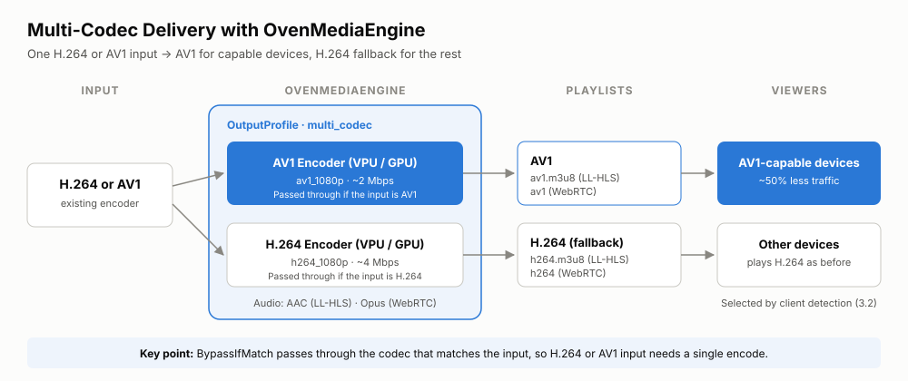

AV1 delivers similar quality to H.264 at about half the bitrate. But if you serve only AV1, viewers whose devices cannot play it get no video at all. Support also varies by browser and by protocol (LL-HLS or WebRTC).
This post shows how to solve this with a **multi-codec setup**: OvenMediaEngine produces both AV1 and H.264 from a single input (H.264 or AV1), and each client picks the codec it can play.

If you have AV1 output running from our previous post, [What Are the Benefits of AV1?](/blog/av1-live-streaming-with-ovenmediaengine), and are preparing a commercial service for a wide range of devices, the sections below walk you through checking device support, a multi-codec configuration, client-side codec selection, and a phased rollout.

{/* truncate */}

## 1. How to tell whether a device can play AV1

Whether a device can play AV1 depends on more than the browser. All of the following must hold:

1. **Protocol and container**: the delivery path you use, such as WebRTC or LL-HLS (fMP4), must support AV1.
2. **Browser or player**: it must recognize and decode the AV1 track on that protocol. The same browser may support AV1 over LL-HLS but not over WebRTC, or the other way around.
3. **Device performance**: the device must decode the target resolution and frame rate smoothly. On devices that can only decode in software, watch for high CPU usage, heat, battery drain, and dropped frames, so check whether hardware decoding is available too.

So do not rely on browser support tables alone. Validate with the actual combination of protocol, container, codec profile, and player your service uses.

## 2. Support by platform

*As of September 2026. Support changes quickly with browser and OS updates, so check the latest information before you publish or deploy.*

| Platform | Browser/OS playback (LL-HLS, etc.) | WebRTC AV1 | Typical hardware decoding |
| --- | --- | --- | --- |
| Windows | Chrome 70+, Firefox 67+, Edge 121+ | Chrome and Edge; Firefox 136+ | NVIDIA RTX 30 series and later, AMD RX 6000 series and later (some models excluded), Intel 11th-gen Xe integrated graphics and Arc |
| macOS | Chrome and Firefox (including software decoding); Safari 17+ only on supported hardware | Chrome, Edge, Firefox 136+; Safari only on devices with a hardware decoder | Apple M3 and later |
| Android | Chrome. From Android 14, AV1 decoding is required on phones and tablets (CDD; hardware or software) | Chrome | Varies by SoC |
| iPhone | Safari and supporting apps on iOS 17+ | Safari only on devices with a hardware decoder | A17 Pro (iPhone 15 Pro and Pro Max), A18 (all iPhone 16 models), and later |
| iPad | Safari on iPadOS 17+ | Safari only on devices with a hardware decoder | iPad Pro (M4 and later), iPad Air (M3 and later), iPad mini (A17 Pro and later) |
| Smart TV | Expanding from some 2020-and-later Samsung, LG, and other models | Varies by app and browser | Varies by model and SoC |
| Set-top boxes and streaming devices | Some Android TV, Google TV, Fire TV, and Roku products | Depends on the app implementation | Some models such as Fire TV Stick 4K Max, Google TV Streamer, and Roku Ultra. Not supported on Apple TV 4K |

*Source: [Can I use](https://caniuse.com/av1), [MDN Web video codec guide](https://developer.mozilla.org/en-US/docs/Web/Media/Guides/Formats/Video_codecs), [WebKit (Safari 17)](https://webkit.org/blog/14445/webkit-features-in-safari-17-0/), Apple Safari [17.5](https://developer.apple.com/documentation/safari-release-notes/safari-17_5-release-notes) and [18](https://developer.apple.com/documentation/safari-release-notes/safari-18-release-notes) release notes, [Android 14 CDD](https://source.android.com/docs/compatibility/14/android-14-cdd), and [Mozilla Bugzilla (Firefox 136 WebRTC AV1)](https://bugzilla.mozilla.org/show_bug.cgi?id=1944878).*

## 3. Handling devices without AV1 support

### 3.1 Multi-codec configuration

The following example produces AV1 (1080p, about 2 Mbps) for AV1-capable devices and H.264 (1080p, about 4 Mbps) as a fallback.
AV1 at 2 Mbps is chosen to give quality similar to H.264 at 4 Mbps (see section 2.1 of the [basic setup post](/blog/av1-live-streaming-with-ovenmediaengine)).
Both video encodes have `BypassIfMatch`, so the output whose codec matches the input is passed through without re-encoding, and only the other one is encoded:

| Input | AV1 output | H.264 output | Encodes per stream |
| --- | --- | --- | --- |
| H.264 | Encode | Pass through | 1 |
| AV1 | Pass through | Encode | 1 |
| H.265 | Encode | Encode | 2 |

Each codec gets one Playlist that serves both LL-HLS and WebRTC. OME uses the AAC rendition for LL-HLS and the Opus rendition for WebRTC, and skips the rendition whose audio codec the protocol does not support.



```xml
<OutputProfiles>
    <HWAccels>
        <Decoder>
            <Enable>true</Enable>
            <Modules>ni:0</Modules>
        </Decoder>
        <Encoder>
            <Enable>true</Enable>
            <Modules>ni:0</Modules>
        </Encoder>
    </HWAccels>

    <OutputProfile>
        <Name>multi_codec</Name>
        <OutputStreamName>${OriginStreamName}</OutputStreamName>

        <!-- AV1: one Playlist for both LL-HLS and WebRTC -->
        <!-- The template creates an AAC and an Opus rendition: LL-HLS uses AAC, WebRTC uses Opus -->
        <Playlist>
            <Name>av1</Name>
            <FileName>av1</FileName>
            <RenditionTemplate>
                <Name>av1_${Height}p</Name>
                <VideoTemplate>
                    <VariantName>av1_1080p</VariantName>
                </VideoTemplate>
                <!-- No audio filter: matches both aac_audio and opus_audio -->
                <AudioTemplate>
                    <EncodingType>all</EncodingType>
                </AudioTemplate>
            </RenditionTemplate>
        </Playlist>

        <!-- H.264 (fallback): same structure -->
        <Playlist>
            <Name>h264</Name>
            <FileName>h264</FileName>
            <RenditionTemplate>
                <Name>h264_${Height}p</Name>
                <VideoTemplate>
                    <VariantName>h264_1080p</VariantName>
                </VideoTemplate>
                <!-- No audio filter: matches both aac_audio and opus_audio -->
                <AudioTemplate>
                    <EncodingType>all</EncodingType>
                </AudioTemplate>
            </RenditionTemplate>
        </Playlist>

        <Encodes>
            <!-- AV1: encode, or pass through if the input is already AV1 -->
            <Video>
                <Name>av1_1080p</Name>
                <Codec>av1</Codec>
                <Bitrate>2000000</Bitrate>
                <Width>1920</Width>
                <Height>1080</Height>
                <Framerate>30</Framerate>
                <KeyFrameInterval>30</KeyFrameInterval>
                <BFrames>0</BFrames>
                <BypassIfMatch><Codec>eq</Codec></BypassIfMatch>
            </Video>
            <!-- H.264 fallback: encode, or pass through if the input is already H.264 -->
            <Video>
                <Name>h264_1080p</Name>
                <Codec>h264</Codec>
                <Bitrate>4000000</Bitrate>
                <Width>1920</Width>
                <Height>1080</Height>
                <Framerate>30</Framerate>
                <KeyFrameInterval>30</KeyFrameInterval>
                <BFrames>0</BFrames>
                <BypassIfMatch><Codec>eq</Codec></BypassIfMatch>
            </Video>
            <Audio>
                <Name>aac_audio</Name>
                <Codec>aac</Codec>
                <Bitrate>128000</Bitrate>
                <Samplerate>48000</Samplerate>
                <Channel>2</Channel>
                <BypassIfMatch><Codec>eq</Codec></BypassIfMatch>
            </Audio>
            <Audio>
                <Name>opus_audio</Name>
                <Codec>opus</Codec>
                <Bitrate>128000</Bitrate>
                <Samplerate>48000</Samplerate>
                <Channel>2</Channel>
                <BypassIfMatch><Codec>eq</Codec></BypassIfMatch>
            </Audio>
        </Encodes>
    </OutputProfile>
</OutputProfiles>
```

This produces the following playback URLs:

| Target | LL-HLS | WebRTC |
| --- | --- | --- |
| AV1-capable devices | `/app/stream/av1.m3u8` | `/app/stream/av1` |
| Devices without AV1 | `/app/stream/h264.m3u8` | `/app/stream/h264` |

:::tip[Things to check]
- For what each setting means (HWAccels, Playlist, Opus audio, and so on), see "4.2 Configuration" in the [basic setup post](/blog/av1-live-streaming-with-ovenmediaengine).
- A passed-through output keeps the resolution, bitrate, and frame structure of your broadcast, not the values in the encode settings. B-frames in an H.264 input can cause problems with WebRTC playback, so either turn off B-frames on the encoder side, or remove `BypassIfMatch` from `h264_1080p` to always re-encode H.264 with `BFrames` set to 0.
- With H.265 input, both AV1 and H.264 are encoded, so size your capacity for two encodes per stream.
- NETINT Quadra cannot decode AV1 in hardware, so with AV1 input the H.264 encode decodes the input in software. Account for that CPU load.
- To support low-end devices, add more Video encodes, such as H.264 720p, and a matching RenditionTemplate.
:::

### 3.2 Client feature detection

On the client, check the supported codecs and decoding performance, then choose either the AV1 or the H.264 Playlist from section 3.1.

#### 1) Check LL-HLS playability

The Media Capabilities API's `decodingInfo()` returns whether a configuration is supported (`supported`), whether playback will be smooth (`smooth`), and whether it is power efficient (`powerEfficient`).
`powerEfficient: true` usually means hardware decoding, although the exact criteria differ by browser.

If the player plays through MSE, query with `type: 'media-source'`; if it uses native HLS, query with `type: 'file'`.
OvenPlayer uses hls.js (MSE) in browsers that have `MediaSource`, and native HLS where `MediaSource` is not available, such as on iPhone, so the example follows the same rule.
If you use a different player that plays through iOS's `ManagedMediaSource`, adjust the condition to match that player.

```javascript
// Match the CODECS value in OME's av1.m3u8 output
// (e.g. Main profile, Level 4.0, 8-bit)
const AV1_CODEC = 'av01.0.08M.08';
const VIDEO = { width: 1920, height: 1080, bitrate: 2000000, framerate: 30 };

async function canPlayAv1Hls({ requireHw = true } = {}) {
  if (!navigator.mediaCapabilities) return false;

  // OvenPlayer uses hls.js (MSE) when MediaSource exists, and native HLS otherwise (e.g. iPhone)
  const useMse = 'MediaSource' in window;

  try {
    const r = await navigator.mediaCapabilities.decodingInfo({
      type: useMse ? 'media-source' : 'file',
      video: { contentType: `video/mp4; codecs="${AV1_CODEC}"`, ...VIDEO },
    });
    // With requireHw, serve AV1 only to power-efficient devices (likely hardware decoding)
    return r.supported && r.smooth && (!requireHw || r.powerEfficient);
  } catch {
    return false; // Unsupported configuration: fall back to H.264
  }
}
```

:::info[Match the codec string]
Depending on the encoder (NETINT, NVENC, and so on), the actual AV1 level may differ from the example (4.0). Check the `CODECS` value in the `av1.m3u8` that OME generates and use it as `AV1_CODEC`.
:::

#### 2) Check WebRTC AV1 support

For WebRTC, `RTCRtpReceiver.getCapabilities()` lists the codecs the browser can receive.
On Safari, AV1 support depends on a hardware decoder, so this check also tells you whether that particular device can receive AV1.
To check performance as well, call `decodingInfo()` with `type: 'webrtc'`.
The `requireHw` option works the same way as for LL-HLS, so both protocols pick codecs by the same rule.

```javascript
async function canPlayAv1WebRtc({ requireHw = true } = {}) {
  // Fall back to H.264 without throwing even if WebRTC is disabled and RTCRtpReceiver is missing
  const caps = window.RTCRtpReceiver?.getCapabilities?.('video');
  const hasAv1 = !!caps?.codecs.some(
    (c) => c.mimeType.toLowerCase() === 'video/av1'
  );
  if (!hasAv1) return false;

  // Check performance (only in browsers that support it)
  try {
    const result = await navigator.mediaCapabilities.decodingInfo({
      type: 'webrtc',
      video: {
        contentType: 'video/AV1',
        width: 1920,
        height: 1080,
        bitrate: 2000000,
        framerate: 30,
      },
    });
    // Same rule as LL-HLS: with requireHw, serve AV1 only to devices likely to decode in hardware
    return result.supported && result.smooth && (!requireHw || result.powerEfficient);
  } catch {
    // Without the performance API we cannot tell about hardware, so fall back to H.264 if requireHw
    return !requireHw;
  }
}
```

#### 3) Pick the stream from the result

Pass the selected Playlist to the player. Here is an OvenPlayer example:

```javascript
async function setupPlayer() {
  const webrtcCodec = (await canPlayAv1WebRtc()) ? 'av1' : 'h264';
  const hlsCodec = (await canPlayAv1Hls()) ? 'av1' : 'h264';

  OvenPlayer.create('player', {
    sources: [
      { type: 'webrtc', file: `wss://<OME_HOST>:3334/app/stream/${webrtcCodec}` },
      { type: 'llhls', file: `https://<OME_HOST>:3334/app/stream/${hlsCodec}.m3u8` },
    ],
  });
}

setupPlayer();
```

When `sources` has several entries, OvenPlayer plays the first one and moves to the next if it fails.
That is **protocol fallback** (WebRTC → LL-HLS). **Codec fallback** (AV1 → H.264) is decided before playback by the detection functions above.

:::warning[Decide your criteria]
- By default (`requireHw: true`), both detection functions also require `powerEfficient`, so desktops that could decode AV1 in software still get H.264. If saving traffic matters more, call them with `{ requireHw: false }`. Use the same value for both functions so the codec does not change during protocol fallback.
- Before deploying, verify the detection code by checking what both functions return on your key environments (for example, Chrome on a PC with an RTX 30 series GPU or later, Safari on an M3 or later Mac, and Safari on an iPhone 15 Pro or later).
:::

### 3.3 Phased rollout and operational metrics

1. Validate encoding performance and playback compatibility in an internal environment.
2. Enable AV1 first on devices with confirmed AV1 hardware decoding.
3. Serve AV1 to a portion of traffic and measure the metrics below.
4. Analyze the failure rate and the cost savings.
5. Expand coverage gradually while keeping the H.264 fallback.

In a multi-codec setup, total traffic savings depend on the share of viewers watching in AV1.
Assuming AV1 cuts bitrate by about 50% compared with H.264, total savings are roughly **AV1 share × 50%**.

| AV1 share | Estimated total traffic savings |
| --- | --- |
| 30% | ~15% |
| 60% | ~30% |
| 90% | ~45% |

The AV1 share is therefore the key metric for judging cost effectiveness. Track these at each stage:

- AV1 share (overall and per device)
- Playback start success and failure rates per codec
- Startup time and rebuffering ratio
- Dropped frames and average playback frame rate
- Average delivered bitrate and total traffic saved
- Encoding server cost per stream

## 4. Conclusion

In a commercial service, rather than offering AV1 alone, run an H.264 fallback alongside it and choose the codec per device with client feature detection.
Start with devices you know decode AV1 in hardware, watch the AV1 share, and widen the rollout as it grows. Every point of AV1 share is roughly half a point of traffic saved.

## 5. Future work

This post has the client (player) decide whether to use AV1 and play one of two separate streams, AV1 or H.264.
In future releases, OvenMediaEngine will let the server set the codec playback priority, so that players automatically pick AV1 first when they can play it.
We plan to do this per protocol:

- **LL-HLS: `SCORE` attribute.** OME will add a `SCORE` to each variant in the master playlist and give AV1 variants a higher score than H.264. Players that support `SCORE` will prefer AV1 among the variants they can play.
- **WebRTC: codec order in the SDP offer.** OME will list the preferred codec (AV1) first in its SDP offer. Browsers usually answer in the offer's order, so those that can play AV1 will select it, and the rest will fall back to H.264.

With these, you will be able to configure **one Playlist that contains both AV1 and H.264**, instead of the two per-codec Playlists in section 3.1.
Players will connect to a single URL, and the server will offer AV1 first and fall back to H.264 without client-side codec selection.
Client feature detection (section 3.2) will still be useful when you want to serve AV1 only to devices with hardware decoding.

## Learn more

- [What Are the Benefits of AV1?](/blog/av1-live-streaming-with-ovenmediaengine) — basic AV1 output setup and playback verification
- [OvenMediaEngine on GitHub](https://github.com/OvenMediaLabs/OvenMediaEngine) — source code, releases, Discussions
- [Hardware Acceleration](/docs/ome-enterprise/features/transcoding-and-processing/hardware-acceleration) — `HWAccels` configuration and supported devices
- [OvenPlayer demo](https://demo.ovenplayer.com/) — playback testing
- [OvenMedia Labs](/company) — technical support and adoption inquiries

## References

- [Can I use — AV1 video format](https://caniuse.com/av1)
- [MDN — Web video codec guide](https://developer.mozilla.org/en-US/docs/Web/Media/Guides/Formats/Video_codecs)
- [WebKit — Safari 17 AV1 support](https://webkit.org/blog/14445/webkit-features-in-safari-17-0/)
- [Apple — Safari 17.5 Release Notes](https://developer.apple.com/documentation/safari-release-notes/safari-17_5-release-notes)
- [Apple — Safari 18 Release Notes](https://developer.apple.com/documentation/safari-release-notes/safari-18-release-notes)
- [Android 14 Compatibility Definition](https://source.android.com/docs/compatibility/14/android-14-cdd)
- [Mozilla Bugzilla — Enable AV1 for WebRTC by default (Firefox 136)](https://bugzilla.mozilla.org/show_bug.cgi?id=1944878)
- [MDN — MediaCapabilities.decodingInfo()](https://developer.mozilla.org/en-US/docs/Web/API/MediaCapabilities/decodingInfo)
