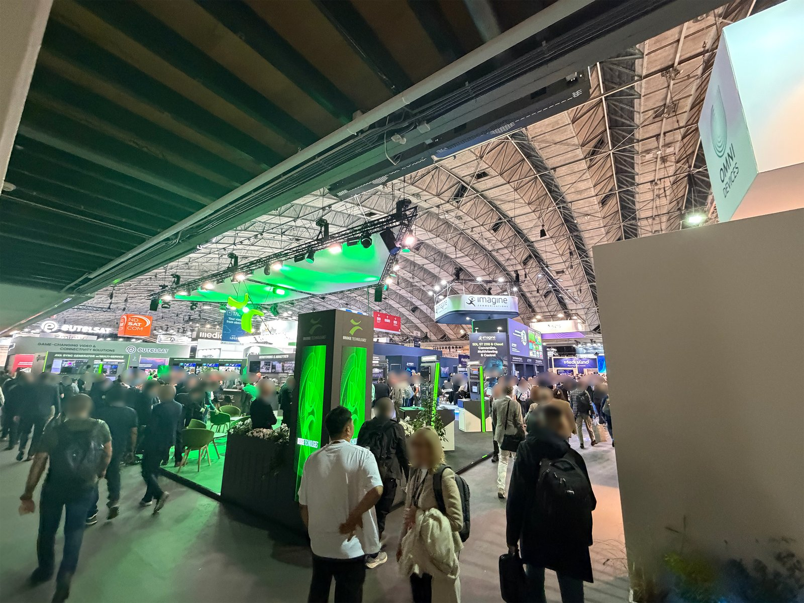
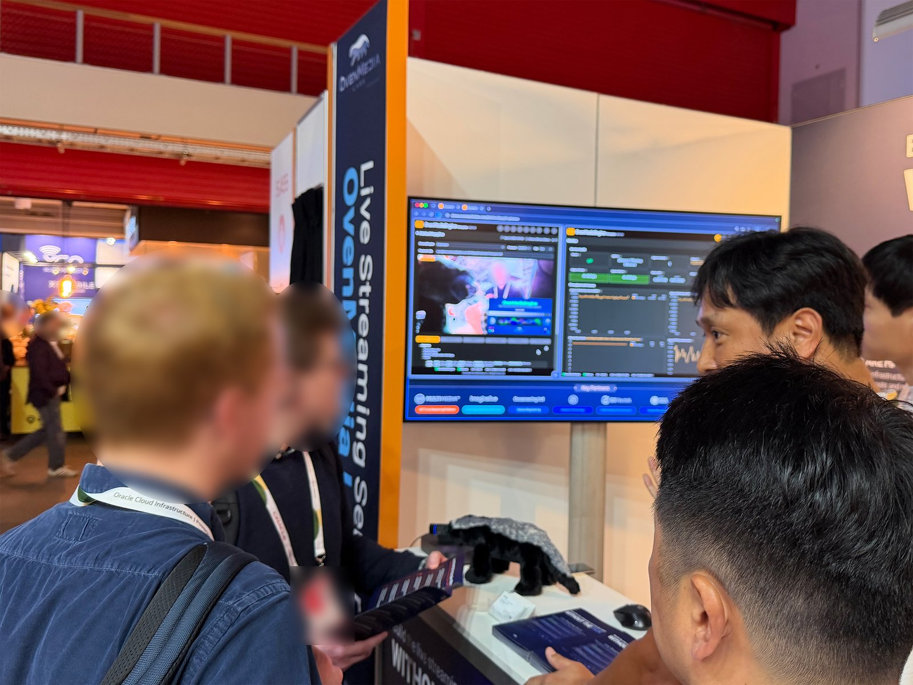
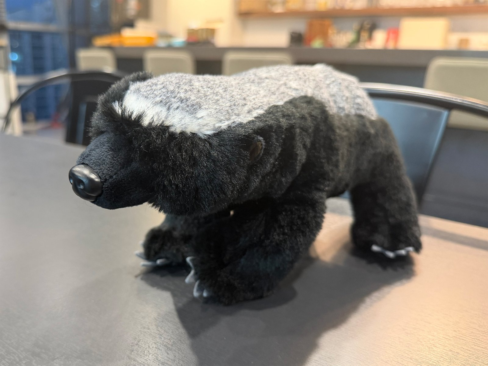

As we wrap up IBC 2026, we find ourselves looking back on more than just four days in Amsterdam. At our booth (5.B55), OvenMediaEngine brought together people from different corners of the industry, each with their own challenges, ideas, and visions for what live streaming could become.

{/* truncate */}

This year, we showcased the full OvenMediaEngine family: **[OvenMediaEngine](/#open-source)**, our open-source live streaming server; **[OvenMediaEngine Enterprise](/#enterprise)**, a self-hosted enterprise live streaming server package built for production environments; and **[OvenMedia Cloud](/om-cloud)**, a fully managed live streaming service delivered by the team behind OvenMediaEngine.

One of the highlights was a live demonstration of the latest **Monitoring and Metrics capabilities in OvenMediaEngine Enterprise**. Introduced in [version 0.21.1](/docs/ome-enterprise/about/release-notes/0.21.1), the new Web Console dashboard gives operators real-time visibility into service health, throughput, active streams, and individual stream quality.

> To learn more about the dashboard, check out our previous post: [Your Live Stream Is Up. That Doesn't Mean It's Healthy](/blog/your-live-stream-is-up-that-doesnt-mean-its-healthy).

But what made this year's IBC truly memorable wasn't just the technology we showcased. It was the conversations that followed. From scaling live streaming infrastructure and hardware-accelerated transcoding to synchronizing multiple video streams and tackling specialized media workflows, every conversation brought a different perspective on the challenges and possibilities of live streaming.

Some visitors had been following OvenMediaEngine for years. Others were trusted partners, familiar faces, or people discovering our work for the very first time. We talked about much more than features, performance, or products. We exchanged ideas about where the live streaming ecosystem is heading, what still needs to improve, and what we might build next.

OvenMediaEngine may be what brings us together, but it's the people and the community around it that make the journey meaningful.

To everyone who stopped by, shared their experiences, and challenged our thinking, thank you for making IBC 2026 such a memorable experience.

If we met at IBC and you'd like to continue our conversation or have any questions, feel free to reach out anytime at [contact@ovenmedia.com](mailto:contact@ovenmedia.com).

## A Little Honey Badger, A Lot of Heart

Our [new honey badger mascot](/blog/from-flame-to-honey-badger) also attracted quite a bit of attention at IBC. And there's a story behind the little fellow that made it to our booth. Our longtime friend, **Brian**, noticed our new honey badger logo and surprised us with a honey badger plush as a gift to celebrate this new chapter of OvenMedia Labs.

It didn't take long for our new furry friend to become a little star of the booth, drawing smiles and attention from visitors throughout the show. The honey badger represents the spirit of OvenMedia Labs: small but fearless, persistent, independent, and always ready to take on a challenge.

But what made Brian's gift especially meaningful wasn't just the mascot itself. It was the thought behind it. Knowing that someone who has been part of our journey for so long still remembers our story, and took the time to celebrate its next chapter with us, meant a great deal.

Thank you, Brian, for the friendship, the memories, and for being part of our story.

## Next Stop: Inter BEE 2026, Japan

Our journey doesn't end in Amsterdam.

This November, we'll be heading to **Inter BEE 2026**, taking place November 18-20 at Makuhari Messe in Chiba, Japan. You'll find us at **Hall 8, Booth 8307**, where we'll continue sharing what we're building with OvenMediaEngine, OvenMediaEngine Enterprise, and OvenMedia Cloud.

We're looking forward to reconnecting with familiar faces, meeting new ones, and continuing the conversations we started in Amsterdam. If you're planning to attend, we'd love to see you there.

> [Find us at Inter BEE 2026](https://www.inter-bee.com/en/forvisitors/exhibitor_info/detail/detail.php?id=230)

**See you in Japan!**
